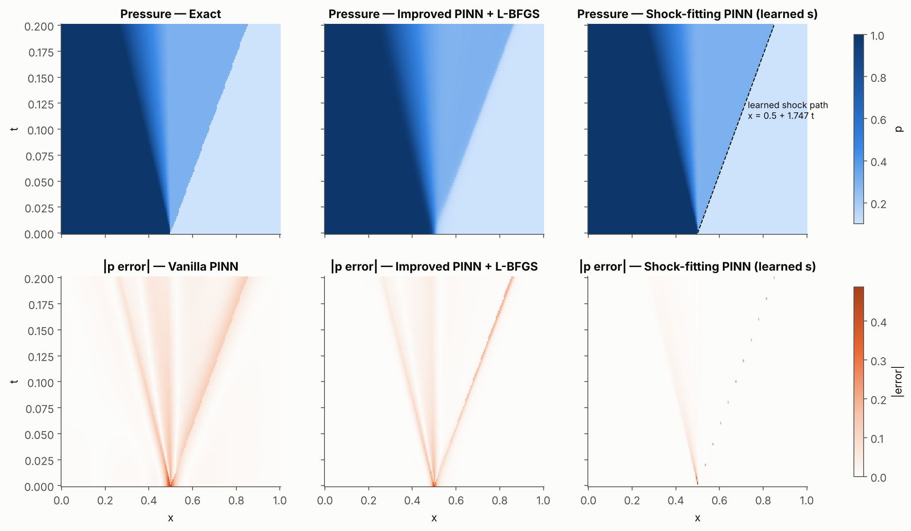
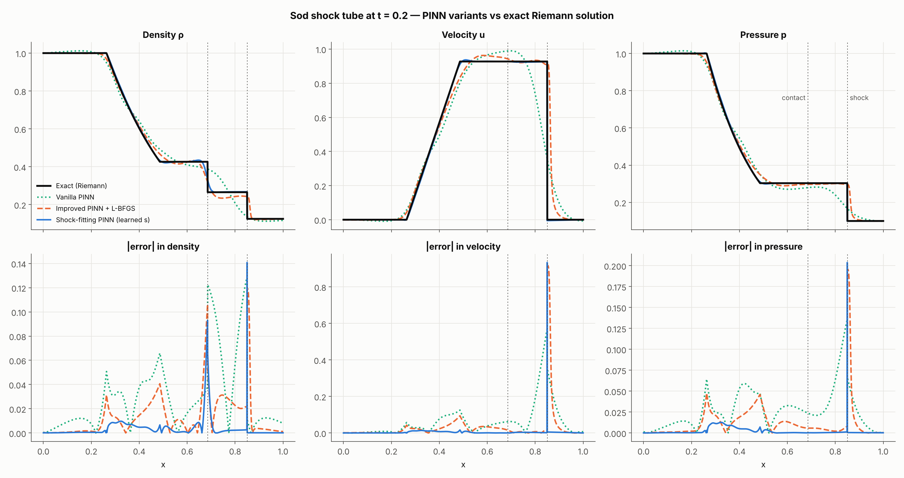
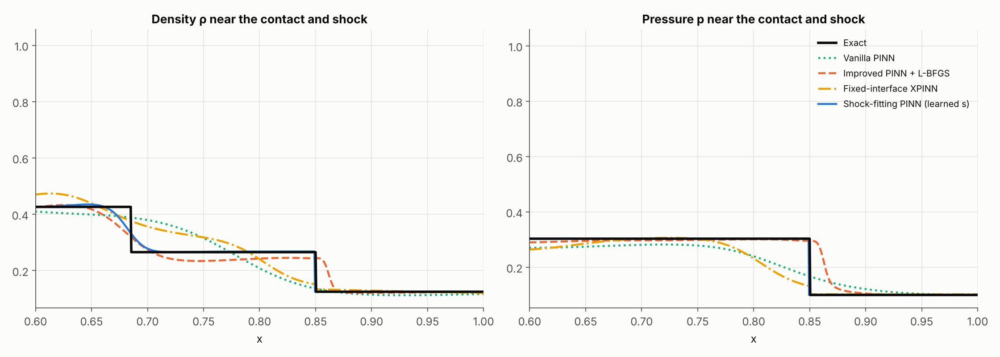
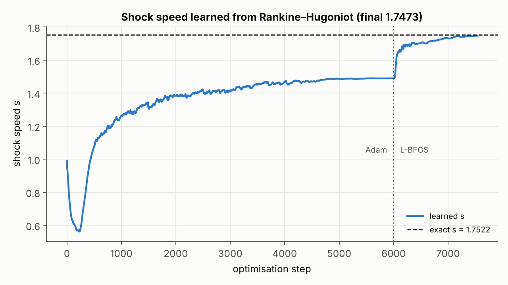
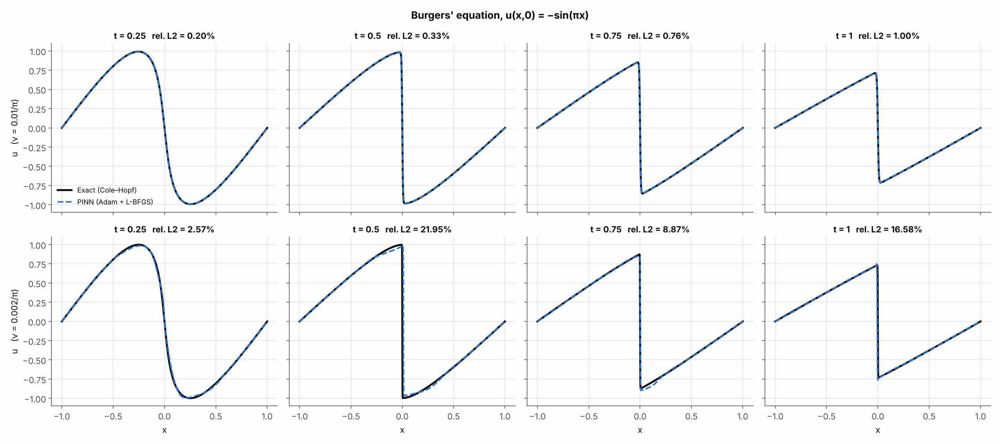

# Physics-Informed Neural Networks for Shocks

[](https://github.com/OWNER/pinn-shock-capturing/actions/workflows/tests.yml)


**Can a physics-informed neural network predict a shock and the pressure field around it?**
This repository answers that on two canonical benchmarks: the **Sod shock tube** (1D Euler) and
**viscous Burgers' equation**. Every result is checked against an exact solution.

A standard PINN smears the shock across ~10 % of the domain. A **shock-fitting PINN** splits the
domain along a moving shock `x_s(t) = 0.5 + s·t` and learns the shock speed `s` from the
Rankine–Hugoniot conditions. It recovers **s = 1.747** (exact 1.7522, −0.3 %) from an initial guess
of 1.0, puts the shock where it belongs and keeps it one grid cell wide. Its pressure error is
**3.4× lower** than an equally optimised single-network PINN.



## Results: Sod shock tube at t = 0.2

All Sod runs use seed 42 on a 2-core CPU. RMSE is evaluated on 2001 points against the exact
Riemann solution. *Shock position* is the 50 % crossing of the pressure jump p* → p_R, and
*shock width* is the 90 %→10 % distance (n/a = profile never reaches 90 % of p*).

| Method | RMSE ρ | RMSE u | RMSE p | rel. L2 p | Shock position | Shock width | Train time |
|---|---|---|---|---|---|---|---|
| Exact | – | – | – | – | 0.8504 | 0 | – |
| Vanilla PINN | 0.0412 | 0.1124 | 0.0363 | 5.85% | 0.8261 | n/a | 28 s |
| PINN + artificial viscosity | 0.0462 | 0.1261 | 0.0440 | 7.09% | 0.8205 | 0.0897 | 71 s |
| Improved PINN (Adam only) | 0.0296 | 0.0995 | 0.0316 | 5.09% | 0.8390 | 0.1037 | 38 s |
| Improved PINN + L-BFGS | 0.0219 | 0.1038 | 0.0254 | 4.08% | 0.8637 | 0.0191 | 98 s |
| Fixed-interface XPINN | 0.0317 | 0.1401 | 0.0355 | 5.71% | 0.8115 | 0.0753 | 39 s |
| **Shock-fitting PINN (learned s)** | **0.0104** | **0.0299** | **0.0075** | **1.21%** | **0.8493** | **0.0004** | 160 s |





### What each variant changes

| Variant | Idea |
|---|---|
| **Vanilla** | One tanh MLP (4×40). Euler residuals in primitive form, exact step initial condition, fixed loss weights. |
| **Artificial viscosity** | Adds ν = 0.005 ∂²/∂x² to every equation. It did **not** help here: the extra viscosity smears the shock further. |
| **Improved** | tanh-smoothed initial condition, causal weighting exp(−εt/T) of the residual, and staged IC/BC weights. |
| **Improved + L-BFGS** | Same network, refined with L-BFGS. This is the control for the shock-fitting PINN, which uses the same optimiser. |
| **Fixed-interface XPINN** | Two networks split at x = 0.85, the shock's position at t = 0.2. **This does not work, and the reason is instructive:** the shock starts at x = 0.5, so it crosses the *left* subdomain for the entire run. |
| **Shock-fitting PINN** | Two networks split along the moving line x = 0.5 + s·t, with `s` a trainable parameter. Rankine–Hugoniot conditions `s[U] = [F(U)]` couple the networks along that line. Each network only ever sees smooth flow (plus the contact), and the exact step initial condition needs no smoothing. |

### The learned shock speed

The Rankine–Hugoniot residual is the only loss term that depends on `s`. Adam alone stalls at
s ≈ 1.49, and runs started from s = 1.0 and from s = 2.5 both end there. The likely trap is the
weak-shock branch, where a near-zero jump satisfies the jump conditions for speeds close to the
acoustic speed. The L-BFGS phase then takes `s` to 1.747.



## Results: Burgers' equation

`u_t + u u_x = ν u_xx` on x ∈ [−1, 1], t ∈ [0, 1], with u(x,0) = −sin(πx) and u(±1, t) = 0.
Each network (4×40) trains for 3000 Adam steps, then L-BFGS. The reference is the analytical
Cole–Hopf solution, which agrees with an independent 2nd-order finite-volume solver to within
10⁻³ (checked in the test suite).

| Burgers | rel. L2 t=0.25 | t=0.5 | t=0.75 | t=1.0 | Train time |
|---|---|---|---|---|---|
| ν = 0.01/π | 0.20% | 0.33% | 0.76% | 1.00% | 125 s |
| ν = 0.002/π | 2.57% | 21.95% | 8.87% | 16.58% | 109 s |



At the classic ν = 0.01/π the PINN is accurate to about 1 %. With 5× less viscosity the front
becomes nearly vertical. The prediction still looks close, but relative L2 punishes even a tiny
displacement of a near-discontinuity, and the error jumps by an order of magnitude.

## Limitations

- **The shock-fitting PINN knows the wave structure in advance.** It assumes a single shock
  starting at x = 0.5 and moving at constant speed. That holds for any Riemann problem, but not
  for flows where shocks form, interact or accelerate. There the interface would need a more
  general parametrisation, such as a network for x_s(t), or level-set tracking.
- **Primitive-variable residuals.** Away from the fitted shock the Euler equations are solved in
  non-conservative form, which does not guarantee correct shock speeds for an *uncaptured* shock.
  The single-network shock positions above are off by 0.01–0.04 for this reason.
- **Single seed and one budget per method.** No hyper-parameter search, no confidence intervals.
- **The contact discontinuity is still smoothed** inside the left network (see the density close-up).

## Next steps

- **Weak-form (variational) PINNs:** integrate the conservation laws against test functions so
  that no derivative is ever taken across a discontinuity.
- **Conservative-form residuals** with entropy-condition penalties for the single-network case.
- **Operator learning (DeepONet / FNO)** over a family of Riemann problems instead of one instance.
- Multi-seed statistics and a 2D case (oblique shock on a wedge).

## Reproduce

```bash
git clone https://github.com/OWNER/pinn-shock-capturing.git
cd pinn-shock-capturing
pip install -e ".[dev]"          # numpy, torch, matplotlib, pytest

pytest -q                        # exact solvers, Rankine-Hugoniot, smoke tests (~10 s)

python scripts/run_sod.py --method shockfit        # one experiment (~3 min on CPU)
python scripts/run_burgers.py --nu-pi 0.01
python scripts/make_figures.py                     # rebuild figures + results/metrics.md
bash scripts/reproduce_all.sh                      # everything (~15 min)
```

Methods for `run_sod.py`: `vanilla`, `artvisc`, `improved`, `improved_lbfgs`, `xpinn`, `shockfit`.
Each run writes `model.pt`, `fields.npz`, `metrics.json` and `history.json` to `results/runs/<method>/`.
The trained weights are committed, so the figures can be rebuilt without retraining.

## Repository layout

```
pinn_shocks/
  exact.py      exact Sod Riemann solver, Cole-Hopf Burgers solution, finite-volume check (NumPy only)
  models.py     MLP, fixed-interface XPINN, shock-fitting PINN with learnable shock speed
  physics.py    Euler and Burgers residuals, initial/boundary conditions, Rankine-Hugoniot residual
  train.py      configs/presets and training loops (Adam, optional L-BFGS refinement)
  metrics.py    RMSE, relative L2, shock position and width
scripts/        command-line experiments, figure generation, reproduce_all.sh
tests/          pytest suite (runs in CI on every push)
results/        figures, metrics table, trained runs
```

## References

- M. Raissi, P. Perdikaris, G. E. Karniadakis. Physics-informed neural networks. *J. Comput. Phys.* 378, 686–707 (2019).
- Z. Mao, A. D. Jagtap, G. E. Karniadakis. Physics-informed neural networks for high-speed flows. *Comput. Methods Appl. Mech. Eng.* 360, 112789 (2020).
- A. D. Jagtap, G. E. Karniadakis. Extended physics-informed neural networks (XPINNs). *Commun. Comput. Phys.* 28, 2002–2041 (2020).
- S. Wang, S. Sankaran, P. Perdikaris. Respecting causality for training physics-informed neural networks. *Comput. Methods Appl. Mech. Eng.* 421, 116813 (2024).
- E. F. Toro. *Riemann Solvers and Numerical Methods for Fluid Dynamics*, 3rd ed. Springer (2009).
- C. Basdevant et al. Spectral and finite difference solutions of the Burgers equation. *Computers & Fluids* 14, 23–41 (1986).

## Author

Ozaif Ali, M.Sc. Aerospace Engineering, TU Darmstadt. Licensed under MIT.
